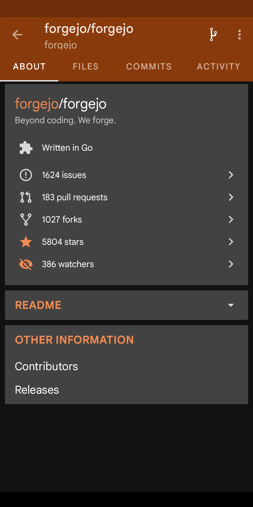

# VibedByKaKi/ForgeDroid

Forgejo client for Android. Fork of [OctoDroid (gh4a)](https://github.com/slapperwan/gh4a) with GitHub support replaced by multi-instance Forgejo login.

The upstream project README is kept in [README.md](../README.md) at the repository root (updated for this fork, with credit to OctoDroid).

|  | [](https://apps.obtainium.imranr.dev/redirect?r=obtainium%3A%2F%2Fapp%2F%257B%2522id%2522%253A%2520%2522com.vibedbykaki.forgedroid%2522%252C%2520%2522url%2522%253A%2520%2522https%253A%252F%252Fgithub.com%252FVibedByKaKi%252FForgeDroid%2522%252C%2520%2522author%2522%253A%2520%2522VibedByKaKi%2522%252C%2520%2522name%2522%253A%2520%2522ForgeDroid%2522%252C%2520%2522preferredApkIndex%2522%253A%25200%252C%2520%2522additionalSettings%2522%253A%2520%2522%257B%255C%2522includePrereleases%255C%2522%253A%2520true%252C%2520%255C%2522fallbackToOlderReleases%255C%2522%253A%2520true%252C%2520%255C%2522apkFilterRegEx%255C%2522%253A%2520%255C%2522.%252A%255C%255C%255C%255C.apk%2524%255C%2522%252C%2520%255C%2522releaseDateAsVersion%255C%2522%253A%2520true%257D%2522%257D) |
| --- | --- |

The APK is a rolling GitHub prerelease on the [`latest`](https://github.com/VibedByKaKi/ForgeDroid/releases/tag/latest) tag. Direct download: [ForgeDroid.apk](https://github.com/VibedByKaKi/ForgeDroid/releases/download/latest/ForgeDroid.apk). In Obtainium, keep **Include pre-releases** and **Use release date as version** on if you add the repo by hand, because the tag never changes. Every CI run also uploads `ForgeDroid-release-<build-number>.apk` as a workflow artifact.

## What this fork changes

- **Forgejo accounts** — Add account picks a preset instance (`codeberg.org`, `gitdab.com`, `git.kaki87.net`, `bolha.dev`, `git.gay`, `opencommit.eu`, `sij.ai`) or a custom base URL.
- **WebView login** — Sign in or register in the dialog; after a session cookie appears, the app creates a long-lived API token (customizable name, default `ForgeDroid`) and stores it with the instance URL.
- **API base** — Requests go to `{instance}/api/v1/` with `Authorization: token …` (no GitHub OAuth client).
- **Application ID** — `com.vibedbykaki.forgedroid`

## Screenshot

## CI

- **Build APK** — runs on push, pull request, and manual dispatch; uploads `ForgeDroid-debug-<run_number>.apk` with `archive: false`.

## Credits

OctoDroid was created by Azwan Adli, Danny Baumann and [contributors](https://github.com/slapperwan/gh4a/graphs/contributors). This repository remains a fork of that work.
